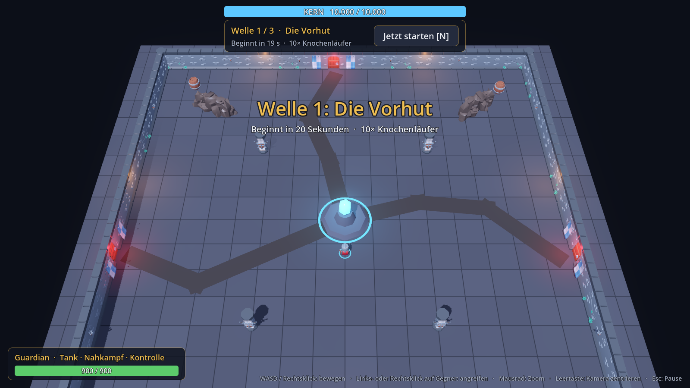
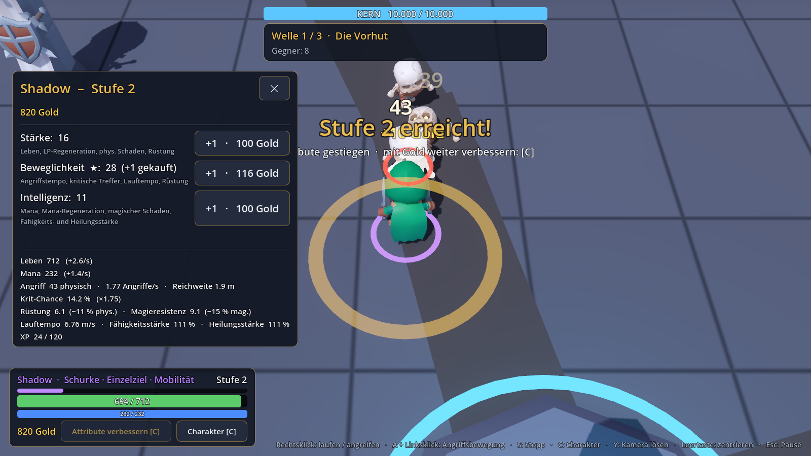
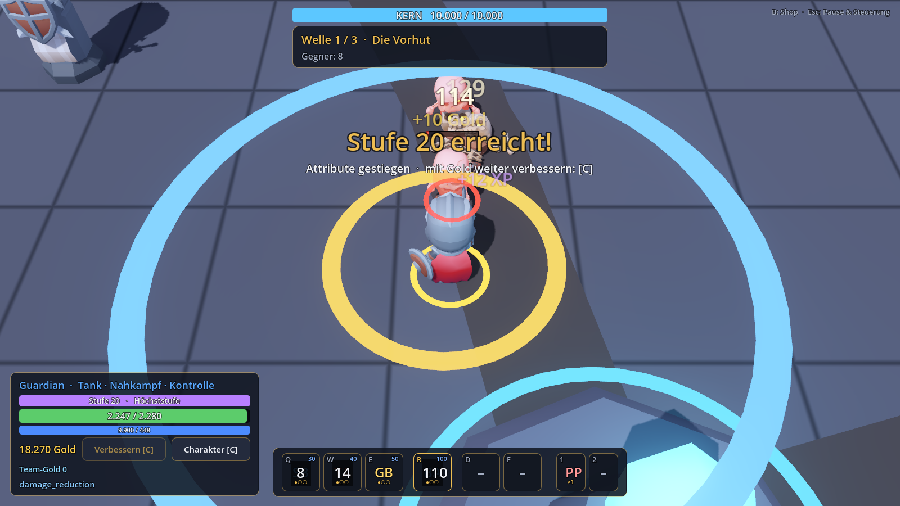
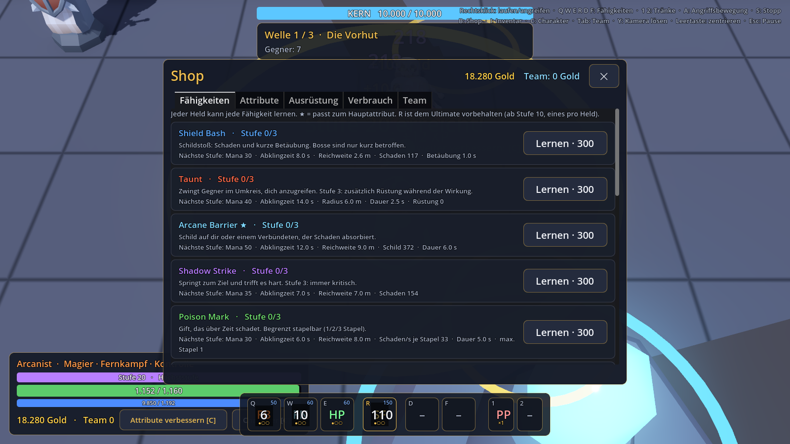

# Heroes of the Last Stand – Projektüberblick

Koop-Hero-Defense in Godot 4 (GDScript) für 1–4 Spieler: Helden verteidigen gemeinsam einen zentralen Kern gegen immer stärkere Gegnerwellen und spezialisieren sich im Laufe der Runde.



## Starten

- **Engine:** Godot 4.4.1 (Standard, nicht .NET), auf diesem Rechner unter `C:\Users\phant\Godot\`
- **Im Editor:** `Godot_v4.4.1-stable_win64.exe` starten → Projekt `heroes-of-the-last-stand/project.godot` importieren → F5
- **Direkt:** `Godot_v4.4.1-stable_win64.exe --path C:\Claude\Gaming\heroes-of-the-last-stand`
- **Tests:** `bash tools/run_tests.sh` (siehe [TESTING.md](TESTING.md))

## Steuerung (MOBA-Stil)

| Eingabe | Wirkung |
|---|---|
| Rechtsklick auf Boden (halten) | zum Punkt laufen / dem Mauszeiger folgen |
| Rechts- oder Linksklick auf Gegner | Gegner angreifen |
| A, dann Linksklick | Angriffsbewegung: hinlaufen, unterwegs Gegner angreifen |
| S | Stopp |
| – | Held greift Gegner in Reichweite automatisch an, wenn er steht |
| Y | Kamera fixieren/lösen (gelöst: Randscrollen) |
| Leertaste (halten) | Kamera auf den Helden zentrieren |
| Mausrad | Zoom |
| N oder Button | nächste Welle sofort starten |
| C | Charakterfenster: Attribute, Werte, Attribut-Käufe |
| Q W E R D F | Fähigkeiten am Mauszeiger wirken (R = Ultimate ab Stufe 5) |
| 1, 2 | Verbrauchsgegenstände (Tränke, Runen) |
| B / I / Tab (halten) | Shop / Inventar / Teamübersicht |
| Esc | schließt offene Fenster, sonst Pausemenü |

Die vollständige Steuerung steht auch im Pausemenü.

## Balancing-Daten (Telemetrie)

Jede Runde, auch eine abgebrochene, wird automatisch als CSV-Tabellen gespeichert unter
`%APPDATA%/Godot/app_userdata/Heroes of the Last Stand/telemetry/`
(Tabellen: `matches`, `wave_players`, `wave_abilities`, `wave_enemies`, `transactions`, `level_ups`, `hero_end`; Schema in `scripts/telemetry/telemetry_store.gd`).
Auswertung: `godot --headless --path . -s res://tools/telemetry_report.gd`. Die CSVs lassen sich auch direkt in SQLite, Excel o. Ä. importieren. Abschalten: `data/balance/game.json` → `telemetry.enabled`.

## Stand der Phasen

| Phase | Inhalt | Stand |
|---|---|---|
| 0 | Projektanalyse, Plan | ✅ abgeschlossen |
| 1 | Spielbarer Kernprototyp | ✅ abgeschlossen |
| 2 | Helden, Attribute, Kampf | ✅ abgeschlossen (siehe unten) |
| 3 | Fähigkeiten, Gold, Shop | ✅ abgeschlossen (siehe unten) |
| 4 | Gegner, 10 Wellen, Boss | offen – nächster Schritt |
| 5 | Koop-Multiplayer | offen |
| 6 | 20 Wellen, Balancing | offen |
| 7 | Speichern, UI, Polishing, Export | offen |

**Phase 1 enthält:** Hauptmenü · Arena (64 × 64 m, Mauerring, 3 Tore mit Spawnpfaden) · schräge 3/4-Kamera mit Zoom · steuerbarer Guardian mit Angriff, Tod und Wiederbelebung · 3 Gegnertypen (Knochenläufer, Schattenhuscher, Grabkoloss) mit Zustandsautomat · Kern mit 10.000 LP, Treffer- und Kritisch-Rückmeldung · 3 datengetriebene Testwellen · HUD (Kern, Welle, Gegnerzahl, Held, Ankündigungen) · Schadenszahlen · Pausemenü · Sieg-/Niederlagebildschirm.

**Phase 2 enthält:** Heldenauswahl im Hauptmenü · **Guardian** (Stärke, Tank), **Shadow** (Beweglichkeit, Krits, schnelle Doppelklingen), **Arcanist** (Intelligenz, magische Geschosse aus 9 m, die verlangsamen) · Attribute Stärke/Beweglichkeit/Intelligenz mit abgeleiteten Werten und Obergrenzen · Rüstung und Magieresistenz · kritische Treffer · Level 1–20 mit Attributwachstum und XP-Verteilung nach Beteiligung · persönliches Gold (Start 500) mit Kill-Gold nach Schadensanteil und Wellenbonus · Attribut-Käufe `round(100 · 1.16^n)` mit Soft Cap 40 · Status-Effekte Verlangsamung/Betäubung · Schwierigkeit steigt pro Welle · Charakterfenster (C) · HUD mit Stufe, XP, Leben, Mana, Gold · 53 automatisierte Tests.



**Phase 3 enthält:** 13 Fähigkeiten mit je 3 Stufen (Shield Bash, Taunt, Arcane Barrier, Shadow Strike, Poison Mark, Fireball, Frost Nova, Healing Pulse, Guardian Blessing; Ultimates Bastion, Shadow Dance, Starfall, Sanctuary) · Fähigkeitsleiste Q W E R D F mit Abklingzeiten, Mana und Stufen · Shop (B) mit Fähigkeiten, Attributen, Ausrüstung, Verbrauch, Team · 9 Gegenstände, Inventar (I) mit 6 Slots, Tasche, 2 Verbrauchsslots, Verkaufen · Team-Gold und drei Kern-Upgrades · faire Belohnungen für Heilung, Schilde, verhinderten Schaden, Kontrolle und Tanken mit Anti-Exploit-Regeln, Rollenbonus und AFK-Erkennung · Teamübersicht (Tab) · erweiterte Telemetrie · 82 automatisierte Tests.




## Ordnerstruktur

```
assets/      KayKit-Modelle (CC0), Shader, Lizenzdateien
data/        JSON-Definitionen: balance/, heroes/, enemies/, waves/, skills/, items/, audio/
scenes/      main/ (Menü, Runde), arena/ (Arena, Kern), heroes/, enemies/
scripts/     core/ (Autoloads), gameplay/, heroes/, enemies/, waves/, skills/, items/, economy/, telemetry/, ui/
tests/       Testläufer und Tests (headless)
tools/       Testskript, Screenshot-Werkzeug, Modell-Inspektor
docs/        diese Dokumentation
```

## Assets und Lizenzen

Alle 3D-Modelle stammen von **Kay Lousberg (KayKit)**, Lizenz **CC0** – kommerziell nutzbar, Namensnennung freiwillig (wird im Hauptmenü genannt). Lizenzdateien: `assets/licenses/`.

- KayKit Adventurers 1.0 – Helden (Knight = Guardian, Rogue_Hooded = Shadow, Mage = Arcanist)
- KayKit Skeletons 1.0 – Gegner
- KayKit Dungeon Remastered 1.0 – Arena-Deko

Quelle: github.com/KayKit-Game-Assets. 

**Effekt-Texturen**: Kenney Particle Pack (CC0), `assets/effects/particles/`. **Eigene Feuer-Bildfolgen** (Feuerkugel, Explosion), in Blender gerendert mit `tools/blender_fire_flipbooks.py`: `assets/effects/flipbooks/`. **Eigene Effekt-Texturen** (Rauch, Energie, Druckwelle, Runenkreis, Lichtsäule, Funkeln, Blitze) mit `tools/blender_effect_textures.py`, Eiskristalle in `assets/models/effects/`. **Eigene Körperanimationen** (Feuerball-Wurf, Sanctuary), in Blender auf dem KayKit-Skelett gebaut mit `tools/blender_hero_animations.py`: `assets/models/heroes_custom/anims/`. **Zusätzliche Animationen und Figuren**: KayKit Character Animations 1.1, Adventurers 2.0, Skeletons 1.1 (Kay Lousberg, CC0), `assets/models/kaykit2/`.

**Sounds** stammen von **Kenney (kenney.nl)**, ebenfalls **CC0**: Impact Sounds, RPG Audio, Digital Audio, Interface Sounds, Music Jingles. Dazu Kampfsounds (Schwung, Klinge, Zauber) aus dem **RPG Sound Pack von artisticdude** (OpenGameArt, **CC0**). Ins Projekt übernommen wurden nur die 95 genutzten Dateien (`assets/audio/`); Lizenzdateien liegen in `assets/licenses/`. Die Zuordnung Ereignis → Sound steht in `data/audio/sounds.json`.

Es werden keine Warcraft-III- oder sonstigen geschützten Inhalte verwendet.

## Weitere Dokumente

[ARCHITECTURE](ARCHITECTURE.md) · [GAME_DESIGN](GAME_DESIGN.md) · [BALANCING](BALANCING.md) · [NETWORKING](NETWORKING.md) · [TESTING](TESTING.md) · [DEVELOPMENT_LOG](DEVELOPMENT_LOG.md)
